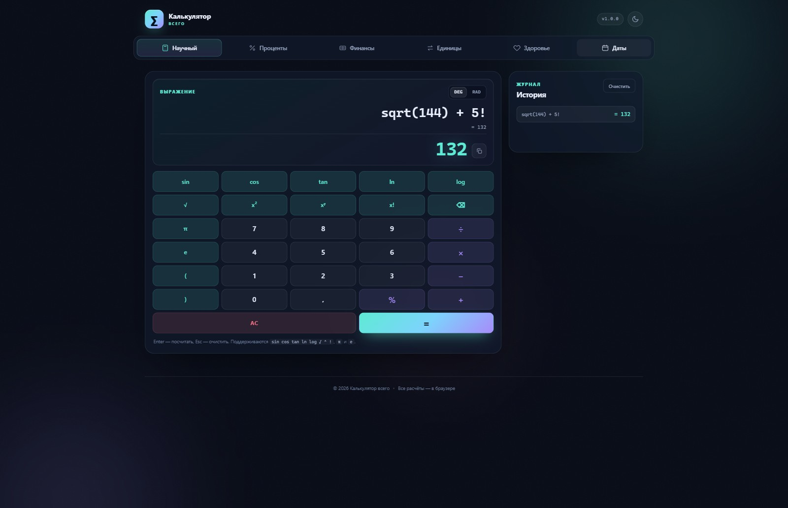

# Калькулятор всего

Универсальное браузерное приложение с калькуляторами на каждый день. Один статический сайт, без сборки, без зависимостей и без сервера: всё считается прямо в браузере.

**Демо:** [laventus7854.github.io/universal-calculator](https://laventus7854.github.io/universal-calculator/)



## Что внутри

- **Научный калькулятор** — выражения с `sin`, `cos`, `tan`, `ln`, `log`, `√`, `^`, `!`, `π`, `e`, режимы DEG/RAD, живой предпросмотр и история вычислений.
- **Проценты** — процент от числа, доля в процентах, прибавка/вычет процента, изменение в процентах.
- **Финансы** — кредит (аннуитетный и дифференцированный) с графиком платежей и остатка долга, вклад с капитализацией, пополнениями и налогом.
- **Единицы** — длина, масса, площадь, объём, скорость, температура, время, данные, давление, энергия, мощность, углы. Перевод сразу во все единицы.
- **Здоровье** — ИМТ с категорией и здоровым диапазоном веса, норма калорий по Миффлину — Сан Жеору, БЖУ и вода.
- **Даты** — разница между датами (включая рабочие дни), прибавление дней, возраст и день рождения.

Дополнительно: тёмная и светлая темы, сохранение истории и темы в `localStorage`, адаптивная вёрстка, работа офлайн (service worker), PWA-манифест.

## Стек

Чистые HTML, CSS и JavaScript. Никаких фреймворков, сборщиков и внешних CDN — сайт открывается даже как локальный файл.

```
universal-calculator/
├── index.html
├── manifest.webmanifest
├── sw.js               # офлайн-кэш приложения
├── assets/
│   ├── favicon.svg
│   ├── styles.css
│   └── js/
│       ├── engine.js   # парсер выражений, конвертеры, финансы, даты
│       └── app.js      # интерфейс и связывание
├── tests/
│   └── engine.test.js  # тесты вычислительного ядра
└── .github/workflows/
    └── deploy.yml      # публикация на GitHub Pages
```

## Локальный запуск

Просто откройте `index.html` в браузере. Для проверки в режиме сайта:

```bash
python -m http.server 8000
# затем http://localhost:8000
```

или

```bash
npx serve .
```

## Тесты

```bash
node tests/engine.test.js
```

Тесты проверяют парсер, приоритет операций, проценты, конвертацию единиц, кредит, вклад, ИМТ, калории и работу с датами.

## Публикация на GitHub Pages

Репозиторий уже содержит workflow `.github/workflows/deploy.yml`. После первого пуша в `main`:

1. Откройте **Settings → Pages**.
2. В разделе **Build and deployment** выберите источник **GitHub Actions**.
3. Дождитесь окончания workflow во вкладке **Actions**.

Сайт будет доступен по адресу `https://laventus7854.github.io/universal-calculator/`.

Можно и без Actions: **Settings → Pages → Deploy from a branch → main / (root)** — сайт статический, сборка не нужна.

## Формулы

- **Аннуитет:** `P = S · r / (1 − (1 + r)^(−n))`, где `r` — месячная ставка, `n` — число месяцев.
- **Вклад:** проценты начисляются ежемесячно, капитализация — с выбранной периодичностью; пополнение добавляется в конце месяца.
- **ИМТ:** `вес / рост²` (кг, м), категории по ВОЗ.
- **Калории:** Миффлин — Сан Жеор, с коэффициентами активности 1,2–1,9.
- **Даты:** разница считается по календарным компонентам, рабочие дни — по будням Пн–Пт (без учёта праздников).

Все финансовые и медицинские расчёты носят справочный характер и не являются индивидуальной рекомендацией.

## Приватность

Приложение не отправляет данные на сервер и не использует аналитику. История вычислений хранится только в вашем браузере (`localStorage`) и очищается кнопкой в разделе «Научный».

## Лицензия

MIT — см. [LICENSE](LICENSE).
